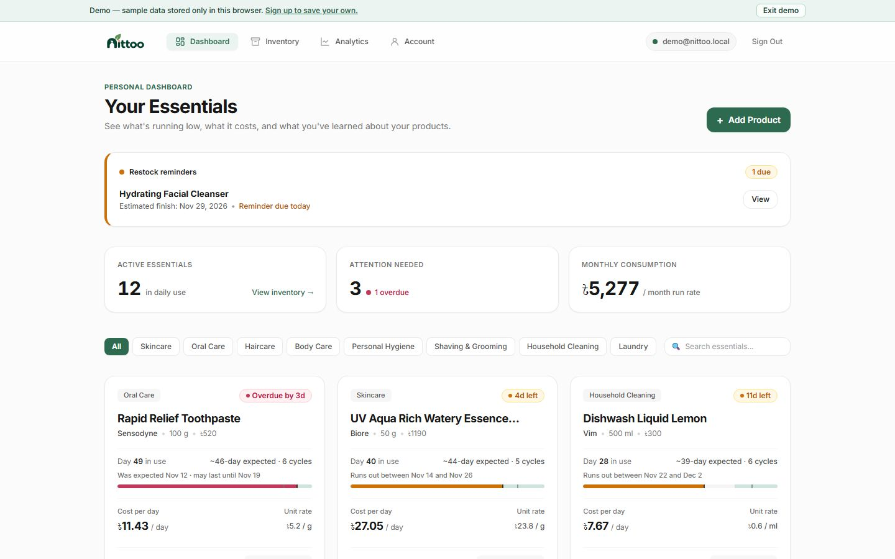
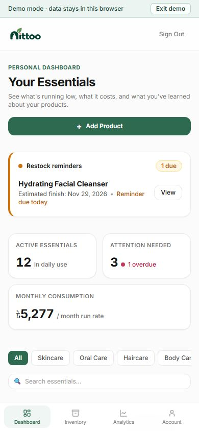
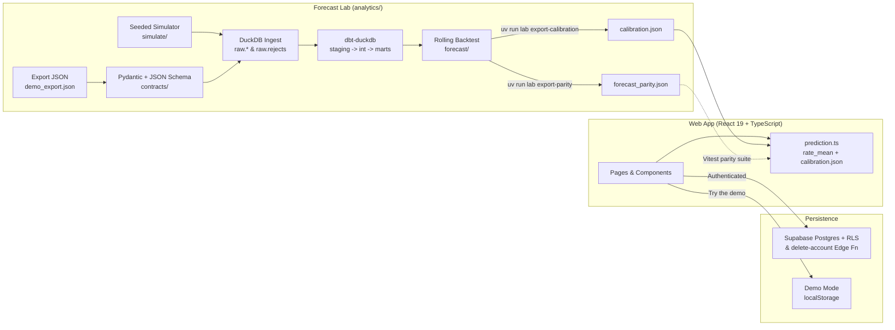

# Nittoo

**Track what you use. Know what it costs.**

A personal consumables tracker and forecasting app that turns everyday purchases into container lifespans, true daily costs, and calibrated run-out windows.

**[Live Demo — Try the demo, no sign-up](https://nittoo.vercel.app)**

[](https://github.com/TahmidShafi/nittoo/actions/workflows/ci.yml)
[](https://github.com/TahmidShafi/nittoo/actions/workflows/analytics.yml)
[](LICENSE)

---

<p align="center">
  
  &nbsp;
  
</p>

## What It Does

- **Container-level tracking:** Follows each bottle or pack from purchase to finish (`active`, `finished`, and unopened `backup` stock) with per-purchase pack-size overrides.
- **Run-out forecasting:** Estimates remaining days and a calibrated P10–P90 run-out window from completed cycle history, with zero fabricated metrics on first-time items.
- **True daily economics:** Separates daily cost of ownership (`৳/day` from the active bottle's price) from bulk unit price (`৳/ml`, `৳/g`), and aggregates an estimated monthly run rate.
- **Restock planning:** Supports relative (`N` days before expected finish) and custom-date reminders that adapt automatically as forecasts update.
- **Data portability & instant demo:** Runs offline-first in Demo Mode (`localStorage`, 12 sample products) or synced via Supabase, with JSON, CSV, Excel, and PDF exports plus validated JSON restore.

---

## Highlights for Reviewers

### Data Engineering
[`analytics/`](analytics/README.md) houses an end-to-end **Forecast Lab** built alongside the app: a strict Pydantic + JSON Schema export contract (`nittoo_export.schema.json`), a seeded NumPy household simulator, idempotent DuckDB ingestion with a `raw.rejects` quarantine table, a `dbt-core` + `dbt-duckdb` warehouse (`staging` -> `intermediate` -> `marts`) with singular and warning SQL tests, rolling-origin backtesting, and automated export of calibrated interval quantiles ([`calibration.json`](src/lib/forecast/calibration.json)) and TypeScript/Python parity fixtures ([`forecast_parity.json`](analytics/fixtures/forecast_parity.json)) back into the web app.

### Forecasting Results
Switching from raw average duration to rule-cleaned, size-normalized consumption rates (`rate_mean (rule_only)`) cuts forecast MAE substantially across pack-size changes on synthetic evaluation histories while maintaining calibrated P10–P90 interval coverage near the nominal 80% target. Full numbers and caveats are generated automatically in [Forecasting Results](#forecasting-results).

### Engineering Quality
- **Automated verification:** Vitest unit/contrast/parity tests, Playwright end-to-end and reduced-motion tests, Python `ruff` + `pytest` + contract tests, and a scheduled report-reproducibility workflow.
- **Database & security:** Idempotent SQL migrations under [`supabase/migrations/`](supabase/migrations/), Row-Level Security (RLS) tenant isolation verified in CI against a local Supabase instance ([`verify-supabase-rls.ts`](scripts/integration/verify-supabase-rls.ts)), and full account deletion via a Supabase Edge Function ([`delete-account`](supabase/functions/delete-account/index.ts)).

### Design & Accessibility
- Grounded in a documented visual specification ([`design.md`](design.md)) using Tailwind v4 `@theme` design tokens.
- Semantic status tokens (`healthy`, `attention`, `critical`, `learning`) verified by automated WCAG contrast ratio unit tests ([`contrast.test.ts`](src/lib/contrast.test.ts)).
- Consistent `prefers-reduced-motion` support across CSS transitions, `ModalShell`, `Toast`, `CountUpValue`, and Recharts, verified by Playwright (`reducedMotion: 'reduce'`).

---

## Architecture



---

## Forecasting Results

<!-- results:start -->
> **SYNTHETIC DATA NOTICE:** All metrics below come from the synthetic simulator (`500 households x 24 months`, rule-clean holdout `n=48,169` — constant-size `n=16,613`, size-change `n=31,556`). The blended gain depends on the simulator's synthetic switch frequency (83.2% of products switch sizes; 37.8% of purchases override).

| Method | Constant-Size MAE (d) | Size-Change MAE (d) | Overall Holdout MAE (d) |
| :--- | ---: | ---: | ---: |
| `baseline (none)` (original app) | 9.48 | 21.59 | 17.42 |
| `baseline (rule_only)` (cleaned) | 4.02 | 17.29 | 12.71 |
| **`rate_mean (rule_only)` (shipped)** | **3.88** | **4.88** | **4.53** |

- **Calibrated P10–P90 interval coverage (holdout):** `83.7%` observed for `rate_mean (rule_only)` (mean width `12.8` days) vs nominal `80%`.
- **Pack-size elasticity caveat:** Rate normalization assumes consumption pace is independent of pack size (`eps=0.0`). When usage scales with pack size, `rate_mean (rule_only)` degrades from `5.84` d (`eps=0.3`, vs `ewma_duration` `7.39` d) to `7.91` d (`eps=0.6`, where `ewma_duration` crosses over at `5.34` d). Real user data is needed to measure true elasticity.
- **Full reports:** [Forecast Backtest](analytics/reports/forecast_report.md) · [Data Quality](analytics/reports/data_quality.md) · [Detector Robustness](analytics/reports/detector_robustness.md) · [Machine-Readable Results](analytics/reports/forecast_results.json)
<!-- results:end -->

---

## How Predictions Work

Nittoo estimates how long your active bottle will last from your own completed cycles:

- **Size-normalized daily pace:** Excluding `0`-day accidental logs and `>= 1000`-day stale entries, Nittoo computes your daily usage rate (`effective pack size ÷ days used`) across matching-unit finished cycles, averages those rates, and divides the active bottle's effective pack size by that rate. If pack sizes aren't recorded, it falls back to your cleaned mean duration; first-time products with no finished cycles show *"First cycle • Learning"* rather than a guessed number.
- **Calibrated run-out window:** Once at least 2 valid cycles exist, Nittoo displays a P10–P90 date range (`Runs out between ... and ...`) from [`calibration.json`](src/lib/forecast/calibration.json), shifting to *"Was expected ... · may last until ..."* if the point estimate passes before the P90 bound.
- **Limitation:** Rate normalization assumes consumption pace does not scale with container size; if larger bottles are used noticeably faster, lifespan can be overestimated.

For full entity definitions and formulas, see [Domain Model](docs/domain-model.md) and [Calculations & Prediction Engine](docs/calculations.md).

---

## Tech Stack

| Layer | Technologies |
| :--- | :--- |
| **Frontend** | React 19, TypeScript 5.7, Vite 6, Tailwind CSS v4, React Router, Recharts |
| **Backend & Auth** | Supabase (PostgreSQL, Auth, Row-Level Security, Deno Edge Functions) |
| **Analytics Lab** | Python 3.12 (`uv`), Pydantic v2, NumPy, DuckDB, `dbt-core` + `dbt-duckdb`, Typer |
| **Testing & CI** | Vitest, Playwright, `eslint`, `ruff`, `pytest`, GitHub Actions, Local Supabase CLI |
| **Hosting** | Vercel (SPA rewrites) |

---

## Running Locally

**Prerequisites:** Node `22` (see [`.nvmrc`](.nvmrc)), Python `3.12`, and [`uv`](https://docs.astral.sh/uv/).

### Web App (runs immediately in Demo Mode with no Supabase setup)

```bash
npm ci
npm run dev
```

To connect a Supabase project, copy `.env.example` to `.env`, set `VITE_SUPABASE_URL` and `VITE_SUPABASE_ANON_KEY`, and apply the migrations in [`supabase/migrations/`](supabase/migrations/).

### Forecast Lab (`analytics/`)

```bash
cd analytics
uv sync
uv run lab all                 # Simulate (500 x 24) -> ingest -> dbt -> reports
uv run lab export-calibration  # Refresh src/lib/forecast/calibration.json
uv run lab export-parity       # Refresh analytics/fixtures/forecast_parity.json
uv run lab readme-results      # Refresh the README results block from forecast_results.json
```

---

## Testing & CI

| Workflow | Scope |
| :--- | :--- |
| [`ci.yml`](.github/workflows/ci.yml) (`ci`) | `tsc --noEmit`, `eslint`, Vitest unit/contrast/parity tests with coverage, Vite production build, Playwright E2E + `prefers-reduced-motion` specs. |
| [`ci.yml`](.github/workflows/ci.yml) (`supabase-rls`) | Starts local Supabase, resets DB with all migrations, and runs [`verify-supabase-rls.ts`](scripts/integration/verify-supabase-rls.ts) to verify cross-tenant isolation. |
| [`analytics.yml`](.github/workflows/analytics.yml) | Regenerates demo & parity fixtures, runs `ruff`, `pytest` (including contract validation), `calibration.json` / `forecast_parity.json` freshness, `lab all --households 50`, and `lab readme-results --check`. |
| [`reproduce-reports.yml`](.github/workflows/reproduce-reports.yml) | Manual + weekly check running `uv run lab reproduce-reports --check` across all committed reports. |

---

## Security & Data

- **Tenant isolation:** Every user-owned table enforces Supabase RLS (`auth.uid() = user_id`), tested automatically in CI against a local Supabase instance ([`docs/supabase-rls-checklist.md`](docs/supabase-rls-checklist.md)).
- **Full account deletion:** Deleting an account invokes the [`delete-account`](supabase/functions/delete-account/index.ts) Edge Function with the user's JWT so both application rows and the `auth.users` record are removed.
- **Export & restore:** Users can export their full history as JSON, CSV, Excel, or PDF (`src/lib/export/`), and restore from JSON backups through a two-phase planner/validator (`src/lib/restore/`).

---

## Engineering Decisions & Lessons

- **Schema drift resolved via idempotent migrations:** Early manual schema edits drifted from `schema.sql`; consolidating into ordered, idempotent migrations under [`supabase/migrations/`](supabase/migrations/) and resetting a local Supabase in CI eliminated environment drift.
- **Data contract caught an export format change:** When the app's JSON export added per-purchase pack size (`v1.1.0`), the Pydantic + JSON Schema contract test failed in CI, forcing the contract update to ship together with the export change.
- **Data-quality checks moved into dbt:** Shifting zero-day, outlier, and referential checks into dbt intermediate models and singular/warning SQL tests keeps raw ingestion fast while surfacing auditable quality metrics.
- **Simulator bug caught by diagnosing detector false positives:** Investigating unexpected false positives in the MAD outlier detector uncovered an initialization bug in the simulator; fixing it and adding the `test_product_default_size_matches_first_purchase` regression test in [`tests/test_dbt_pipeline.py`](analytics/tests/test_dbt_pipeline.py) made synthetic benchmarks trustworthy.
- **Honest dev/holdout evaluation & shipping the simpler model:** Selection was frozen on dev seed `7` and evaluated once on holdout seed `4001`. Although `rate_mean (rule_plus_rate_outlier)` was the mechanical winner, we shipped `rate_mean (rule_only)` because the extra gain was small (`95% CI` documented in the backtest report), degraded under noise and elasticity, and avoided porting an unreliable detector.
- **Per-purchase pack size discovered through analysis:** Modeling pack sizes only on `products` distorted lifespans when users bought different bottle sizes; adding per-purchase `size_value`/`size_unit` overrides and rate normalization fixed cross-size forecasts.
- **Account deletion via Edge Function:** Client-side deletion could only clear app tables; adding the `delete-account` Edge Function ensured the underlying Supabase Auth user is actually deleted.

---

## Limitations & Roadmap

- **Real-usage data for elasticity:** Synthetic stress tests show duration-based `ewma_duration` crosses over `rate_mean` between `eps=0.3` and `eps=0.6`; real opt-in usage data is needed to measure actual pack-size elasticity.
- **Multi-currency formatting:** Currently defaults to `BDT` (`৳`) formatting; per-user currency preferences are planned.
- **Web Push notifications:** Restock reminders currently surface in-app on Dashboard and Product Detail; background Web Push alerts are planned.

---

## License

MIT — see [LICENSE](LICENSE). Historical build notes are archived in [`docs/archive/`](docs/archive/README.md).
