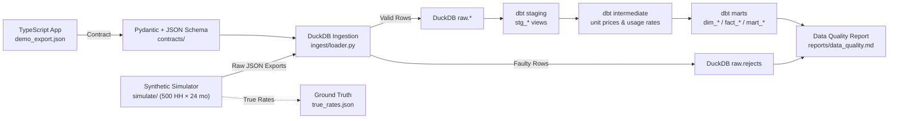

# Nittoo Forecast Lab (`analytics/`)

> **Synthetic Data Notice:** All household exports, prices, vendors, consumption cycles, and ground-truth rates generated by this lab are **100% SYNTHETIC** (`simulate/`). They do not come from real Nittoo users.

## Architecture



## Layers

| Component | Purpose |
| :--- | :--- |
| `contracts/` | Pydantic v2 models (`NittooExportBackup`) and JSON Schema mirroring `src/lib/export/json.ts`, verified against `fixtures/demo_export.json`. |
| `simulate/` | Seeded NumPy generator creating 500 synthetic households × 24 months across 40 Bangladesh-relevant product archetypes with pack-size switching, category inflation, mild seasonality, abandonment, and ~2% injected data-quality faults (`ASSUMPTIONS.md`). |
| `ingest/` | Bulk DuckDB NDJSON loader validating every export file against `NittooExportBackup`, isolating malformed files, duplicate purchases, 0-day cycles, `finished < opened`, and 1000-day outliers into `raw.rejects`. Idempotent on re-runs. |
| `dbt/` | `dbt-core` + `dbt-duckdb` warehouse (`staging` → `intermediate` → `marts`: `dim_product`, `dim_vendor`, `dim_date`, `fact_purchase`, `fact_consumption_cycle`, `mart_monthly_spend`, `mart_category_price_index`), schema & custom SQL tests, plus `dbt docs generate`. |
| `reports/` | Generates `analytics/reports/data_quality.md` summarizing row counts per layer, rejects by reason code, and dbt test results. |

## How to Run

From `analytics/` (Python 3.12 managed via `uv`):

```bash
uv sync
uv run lab all                 # Default: 500 households × 24 months
uv run lab all --households 50 --months 12
```

Individual pipeline stages and checks:

```bash
uv run lab simulate --households 500 --months 24
uv run lab ingest
uv run lab transform
uv run lab report
uv run ruff check .
uv run pytest
```
