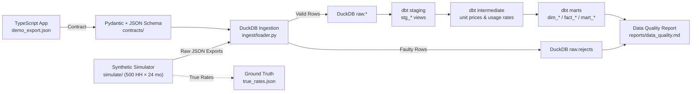

# Nittoo Forecast Lab (`analytics/`)

> **Synthetic Data Notice:** All household exports, prices, vendors, consumption cycles, and ground-truth rates generated by this lab are **100% SYNTHETIC** (`simulate/`). They do not come from real Nittoo users.

## Architecture



## Layers

| Component | Purpose |
| :--- | :--- |
| `src/nittoo_lab/contracts/` | Pydantic v2 models (`NittooExportBackup`) and JSON Schema mirroring `src/lib/export/json.ts`, verified against `fixtures/demo_export.json`. |
| `src/nittoo_lab/simulate/` | Seeded NumPy generator creating 500 synthetic households × 24 months across 40 Bangladesh-relevant product archetypes with pack-size switching, category inflation, mild seasonality, abandonment, and ~2% injected data-quality faults (`ASSUMPTIONS.md`), plus ground-truth & injected-faults manifests. |
| `src/nittoo_lab/ingest/` | Bulk DuckDB NDJSON contract boundary validating every export file against `NittooExportBackup` and referential/DB constraints (`INVALID_EXPORT_SCHEMA`, `MISSING_PRODUCT_REF`, `MISSING_PURCHASE_REF`, `FINISHED_BEFORE_OPENED`) into `raw.rejects`. Idempotent on re-runs. |
| `dbt/` | `dbt-core` + `dbt-duckdb` warehouse (`staging` deduplication → `intermediate` MAD z-score & zero-day quality flags → `marts`: `dim_product`, `dim_vendor`, `dim_date`, `fact_purchase`, `fact_consumption_cycle`, `mart_monthly_spend`, `mart_category_price_index`), singular & warning SQL tests, plus `dbt docs generate`. |
| `src/nittoo_lab/reporting/` | Generates `analytics/reports/data_quality.md` summarizing row counts per layer, contract rejects, fault-detection precision/recall/F1 vs ground truth, and dbt test results. |
| `reports/` | Generated portfolio snapshot output (`data_quality.md`) and tuning log (`detector_tuning.md`). |

> **Fault-Detection Note:** The four rule-based fault types (`finished_before_opened`, `zero_day_cycle`, `outlier_1000_day`, `duplicate_purchase`) are detected by deterministic rules matching their injection definitions, so 100% precision/recall is expected. The **`subtle_duration_outlier`** detector (per-household-product MAD on `consumption_rate_per_day`) is the real statistical test; its performance across cycle-noise levels and outlier severities is characterized in `reports/detector_robustness.md` rather than by a single headline number.

## How to Run

From `analytics/` (Python 3.12 managed via `uv`):

```bash
uv sync
uv run lab all                 # Default: 500 households × 24 months
uv run lab all --households 50 --months 12
```

Individual pipeline stages and checks:

```bash
uv run lab simulate --households 500 --months 24
uv run lab ingest
uv run lab transform
uv run lab report
uv run lab forecast
uv run lab export-calibration
uv run lab export-parity
uv run ruff check .
uv run pytest
```

## Reproducing Committed Reports

- **`reports/data_quality.md`** (holdout seed `2027`, `500 × 24`):
  ```bash
  rm -f data/nittoo.duckdb
  uv run lab simulate --households 500 --months 24 --seed 2027
  uv run lab ingest
  uv run lab transform --no-docs
  uv run lab report
  ```
- **`reports/forecast_report.md` & `reports/forecast_results.json`** (`500 × 24` across dev `7`, holdout `4001`, 2.5× noise `4002`, and pack-size elasticity `4003`/`4004`):
  ```bash
  uv run lab forecast --full
  ```
- **`reports/detector_robustness.md`** (frozen-threshold MAD sweep across seeds `3001`–`3006`, `200 × 24`):
  ```bash
  uv run lab robustness
  ```
- **Regenerate & verify all committed reports + `forecast_results.json`** (used by the weekly/manual `reproduce-reports.yml` workflow):
  ```bash
  uv run lab reproduce-reports
  uv run lab reproduce-reports --check
  ```
